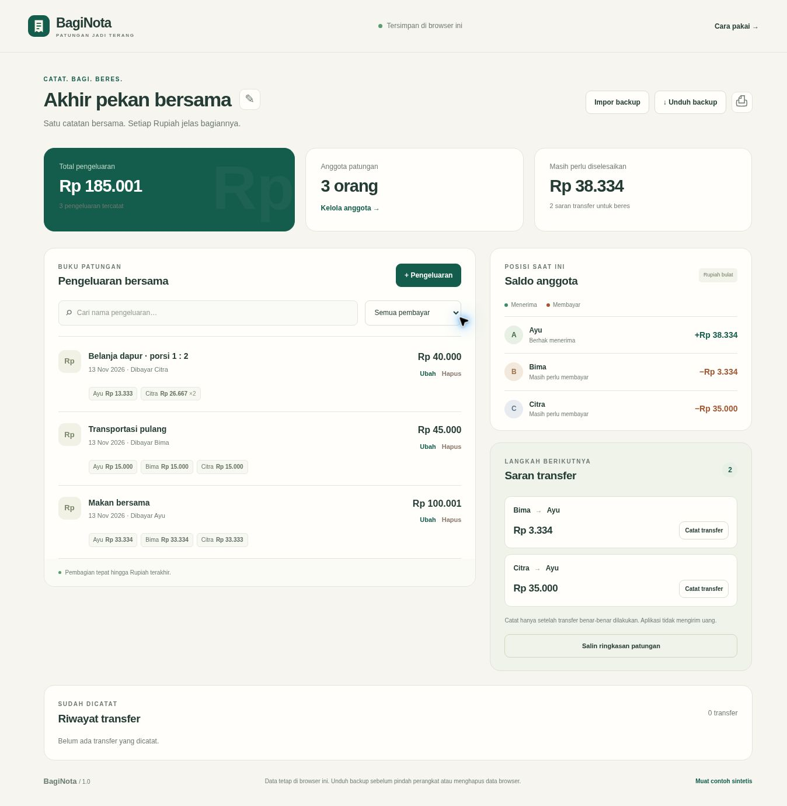

# BagiNota

**Catat pengeluaran, bagi dengan tepat, lalu bereskan patungan.**

BagiNota adalah aplikasi web lokal untuk teman kos, kelompok perjalanan, atau
mahasiswa yang sering membayar bergantian. Semua pekerjaan utama dilakukan lewat
form, tombol, pratinjau pembagian, saldo, dan riwayat transfer.

Tidak ada dependensi npm/pip untuk pemakaian. Cukup Python dan browser modern;
seluruh aset tersedia di proyek dan tidak memakai CDN.



## Lima fitur yang terhubung

1. **Patungan dan anggota:** beri nama kelompok, tambah/ubah anggota, dan cegah
   penghapusan anggota yang masih dirujuk catatan.
2. **Pengeluaran dengan pratinjau:** tambah, ubah, hapus, cari, atau filter
   pengeluaran berdasarkan pembayar. Peserta tiap pengeluaran dapat berbeda;
   bobot 1 : 2 membagi biaya sesuai porsi tersebut.
3. **Saldo dan saran transfer:** lihat siapa perlu membayar atau menerima,
   dengan pembagian Rupiah bulat tanpa selisih.
4. **Pencatatan pelunasan:** catat transfer penuh atau sebagian setelah uang
   benar-benar ditransfer. Saldo diperbarui; catatan yang keliru bisa dibatalkan.
5. **Penyimpanan dan berbagi:** penyimpanan browser, backup/impor JSON tervalidasi,
   salin ringkasan teks, serta tampilan cetak melalui dialog cetak browser.

## Instalasi dan menjalankan

Prasyarat: **Python 3.10+** dan Chrome, Edge, atau Firefox modern dengan JavaScript
dan penyimpanan lokal diizinkan. Python 3.12 digunakan dalam pengujian.

### Windows

1. Unduh ZIP dan **ekstrak seluruh isinya**.
2. Klik dua kali **`Mulai_App.cmd`**.
3. Browser akan membuka **http://127.0.0.1:8731**. Biarkan jendela peluncur
   terbuka selama aplikasi dipakai.

Peluncur mencoba `py -3` lalu `python`. Jika keduanya tidak ditemukan, pasang
Python dari sumber resminya dan pastikan peluncurnya tersedia pada PATH.

### Linux/macOS atau alternatif Windows

Dari folder proyek:

```sh
python server.py
```

Pada sistem yang menamainya `python3`, gunakan `python3 server.py`.
Untuk menutup server tekan Ctrl+C. Jika browser tidak terbuka otomatis, buka
alamat di atas secara manual.

Jangan membuka `web/index.html` melalui `file://`: modul JavaScript perlu dilayani
melalui HTTP. Peluncur hanya mendengarkan pada `127.0.0.1`, bukan jaringan umum.
Tidak diperlukan Docker, database server, atau instalasi paket tambahan.

Jika port dipakai aplikasi lain:

```sh
python server.py --port 8732
```

**Penyimpanan browser terpisah menurut alamat dan port.** Gunakan alamat serta
port yang sama untuk membuka data lama. Untuk memindahkannya, unduh backup dari
alamat lama lalu impor pada alamat baru. `localhost` dan `127.0.0.1` juga memiliki
penyimpanan yang berbeda.

## Cara mencoba

Klik **Coba data contoh**, lalu konfirmasikan pemuatan data sintetis. Contoh itu
menggantikan patungan aktif, sehingga unduh backup terlebih dahulu bila perlu.

| Pengeluaran sintetis | Pembayar | Nominal | Peserta / bobot |
| --- | --- | ---: | --- |
| Makan bersama | Ayu | Rp100.001 | Ayu 1, Bima 1, Citra 1 |
| Transportasi pulang | Bima | Rp45.000 | Ayu 1, Bima 1, Citra 1 |
| Belanja dapur | Citra | Rp40.000 | Ayu 1, Citra 2 |

Hasil: total **Rp185.001**; Ayu menerima **Rp38.334**, Bima membayar **Rp3.334**,
dan Citra membayar **Rp35.000**. Catat kedua saran transfer untuk menjadikan semua
saldo nol. Untuk catatan sendiri, buka **Kelola anggota**, lalu **+ Pengeluaran**.

Nominal dapat ditulis `45000` atau `45.000`. Pecahan Rupiah, tanda minus, dan
notasi seperti `1e3` ditolak. Pembayar boleh tidak ikut menjadi peserta biaya.

Tombol **Catat transfer** hanya merekam transaksi di luar aplikasi; tidak
mengirim uang atau membuktikan bahwa transfer bank terjadi. Mengubah atau
menghapus pengeluaran menghitung ulang saldo tetapi mempertahankan riwayat
transfer, sehingga arah kewajiban dapat berubah.

## Jaminan perilaku dan keputusan teknis

### Jumlah bagian selalu sama dengan nominal

Untuk dokumen valid, setiap pengeluaran dibagi dengan metode **largest remainder**:

1. Hitung `nominal × bobot / jumlah_bobot` memakai bilangan bulat.
2. Ambil bagian bulat setiap peserta.
3. Bagikan sisa Rp1 berdasarkan sisa pembagian terbesar. Jika sama, urutan
   anggota yang tersimpan menjadi penentu.

Rp100.001 untuk tiga orang dengan bobot sama menghasilkan Rp33.334, Rp33.334,
Rp33.333. Jumlah bagian selalu tepat, semua bagian tidak negatif, dan jumlah
saldo seluruh anggota selalu nol. Urutan peserta dalam JSON tidak mengubah
hasil. Mengubah **urutan anggota** pada backup dapat mengubah penerima sisa Rp1.
Rupiah tidak dihitung dengan pembulatan floating point.

Saran transfer memasangkan debitur dan kreditur dalam urutan anggota secara
deterministik. Menjalankan semua saran pada keadaan yang dihitung akan
menyelesaikan saldo; algoritme ini tidak menjamin jumlah transfer minimum
secara global. Tidak ada biaya transfer atau kurs mata uang.

### Penyimpanan gagal tidak mengganti keadaan aktif

Seluruh backup divalidasi sebelum disimpan. Dokumen aktif baru diganti **setelah
`localStorage.setItem` berhasil**. JSON rusak, referensi anggota hilang, versi
asing, ukuran berlebih, dan kegagalan tulis tidak mengganti dokumen aktif.
Jika data lokal rusak saat dimuat, aplikasi menawarkan unduh salinan mentah
dan reset eksplisit; tidak menghapusnya otomatis.

Pemeriksaan baseline dan notifikasi tab lain membantu menolak penyimpanan dari
tab yang sudah tertinggal. Ini **bukan transaksi lintas tab**: pemeriksaan dan
penulisan tidak memiliki compare-and-swap. Pakai **satu tab aktif**. Jaminan
kegagalan tulis berlaku pada operasi aplikasi, bukan jaminan terhadap kerusakan
perangkat, penghapusan data browser, atau penulisan serentak dari luar aplikasi.

## Struktur kode

| Berkas | Tanggung jawab |
| --- | --- |
| `web/model.mjs` | Validasi skema, alokasi, saldo, transfer, dan operasi domain |
| `web/storage.mjs` | Backup JSON, batas ukuran, persistensi dan pemeriksaan baseline |
| `web/app.mjs` | Form, pratinjau, dialog, pencarian, unduhan dan umpan balik |
| `web/index.html`, `web/styles.css` | Antarmuka, tata letak responsif dan aturan cetak |
| `server.py`, `Mulai_App.cmd` | Peluncur lokal dan penyajian aset yang diizinkan |
| `tests/` | Tes domain, integrasi persistensi, kegagalan, dan HTTP nyata |

DOM menggunakan `textContent` untuk data pengguna. Peluncur memiliki daftar aset
yang eksplisit sehingga tidak menyajikan berkas komputer lainnya. Data patungan
tidak dikirim ke server; server hanya menyajikan aset statis.

## Pengujian

Penggunaan sehari-hari tidak membutuhkan Node.js. Untuk menjalankan tes
JavaScript, gunakan **Node.js 20+** (yang diuji: Node.js 24.22.1).

```sh
npm run check
npm test
python -m unittest discover -s tests -p "test_*.py" -v
```

Tidak perlu `npm install` karena tes memakai `node:test` dan `node:assert` bawaan.
Tes integrasi mencakup simpan → buka ulang → lunasi → ekspor → impor, penolakan
impor rusak, kegagalan tulis, tab tertinggal, serta pemulihan data lokal rusak.
Tes invarian memakai 600 skenario sintetis deterministik. Lihat
[`docs/PENGUJIAN.md`](docs/PENGUJIAN.md) untuk hasil aktual dan batas verifikasi UI.

## Batas pemakaian

- Satu patungan aktif per origin/browser; tidak ada akun atau sinkronisasi.
  Backup adalah cara berpindah kelompok atau perangkat.
- Maksimal 24 anggota, 500 pengeluaran, 500 catatan transfer, bobot 1–100,
  dan Rp1 miliar per pengeluaran/catatan transfer. Saran melebihi batas satu
  transfer dapat dicatat sebagian secara bertahap.
- Backup UTF-8 maksimal 1.000.000 byte, termasuk format saat ekspor. Kapasitas
  itu dapat tercapai sebelum batas jumlah catatan. Aplikasi menolak perubahan
  yang akan menghasilkan backup terlalu besar.
- Penyimpanan browser dapat hilang ketika data situs dihapus atau sesi privat
  ditutup. Unduh backup berkala. File backup berisi nama dan nominal tanpa
  enkripsi; bagikan sesuai kebutuhan kelompok.
- Tampilan menyesuaikan lebar layar, tetapi pengujian browser aktual dilakukan
  di desktop. Tidak ada klaim uji perangkat seluler atau uji lapangan.

Contoh dan seluruh tes memakai data sintetis; tidak ada klaim riset lokal,
wawancara, atau data pengeluaran milik orang lain.

## Lisensi

MIT, lihat [LICENSE](LICENSE).
